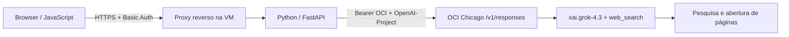

# Grok Web Search via OCI

POC de chatbot com interface JavaScript e backend Python/FastAPI. Usa Grok (padrão `xai.grok-4.3`, configurável por `OCI_MODEL`) pela OCI Generative AI e habilita a ferramenta nativa `web_search` na Responses API. A aplicação chama exclusivamente o endpoint OCI.

## Estrutura

```text
.
├── app.py                          # Backend e autenticação
├── static/
│   ├── index.html                  # Interface e estilos
│   └── app.js                      # Chat, histórico e citações
├── requirements.txt
├── requirements-test.txt           # TestClient para matriz de modelos
├── Dockerfile
├── .dockerignore
├── .gitignore
├── .env.example                    # Variáveis sem credenciais
├── validate.py                     # Validação REST com inferência real
├── test_models.py                  # Matriz de modelos pela mesma aplicação
└── evidence/
    ├── RELATORIO.md                # Resultados da POC
    ├── validation-summary.json     # Evidências selecionadas
    └── grok-websearch-models.json   # Matriz de compatibilidade datada
```

## Configuração

Requer Python 3.12 ou Docker, uma chave OCI Generative AI e um projeto GenAI ativo na região `us-chicago-1`, com permissão para inferência e Responses API.

Na raiz do repositório:

```bash
cp .env.example .env
chmod 600 .env
```

Preencha `.env`:

| Variável | Finalidade |
|---|---|
| `OCI_BASE_URL` | `https://inference.generativeai.us-chicago-1.oci.oraclecloud.com/v1` |
| `OCI_MODEL` | Modelo Grok; padrão `xai.grok-4.3` |
| `OCI_API_KEY` | Chave OCI Generative AI |
| `OCI_PROJECT_ID` | Identificador de projeto ativo em Chicago |
| `APP_PASSWORD` | Senha forte para o usuário `poc` |
| `APP_BASE_URL` | URL pública ou local, com o prefixo de publicação; usada por validate.py |

`.env` é ignorado pelo Git e pelo build Docker. As credenciais OCI ficam no backend. O histórico de conversa permanece na página e é reenviado a cada turno.

## Executar localmente

```bash
python3 -m venv .venv
. .venv/bin/activate
pip install -r requirements.txt
set -a
. ./.env
set +a
uvicorn app:app --host 127.0.0.1 --port 8080
```

Abra `http://localhost:8080/`. A autenticação solicita usuário `poc` e a senha definida em `APP_PASSWORD`.

Com Docker:

```bash
docker build -t poc-grok-websearch:1 .
docker run -d --name poc-grok-websearch --restart unless-stopped \
  --env-file .env -p 127.0.0.1:8080:8080 poc-grok-websearch:1 \
  uvicorn app:app --host 0.0.0.0 --port 8080
```

## Publicar na VM

Copie o repositório e configure `.env` na VM. Faça o build com o [Dockerfile](Dockerfile) e execute o container em uma rede acessível ao proxy reverso. Publique por HTTPS, encaminhando para a porta interna `8080`.

O comando padrão da imagem configura `--root-path /grok-poc`. Para esse modo, publique em `/grok-poc/` e remova o prefixo `/grok-poc` no proxy antes de encaminhar ao backend. Para publicação na raiz do domínio, use o comando uvicorn sem `--root-path`, como no exemplo Docker acima. Ajuste `APP_BASE_URL` para a URL completa, incluindo o prefixo quando usado.

Basic Auth requer HTTPS fora do ambiente local. A POC limita a concorrência a duas inferências, mas não impõe limite financeiro por usuário nem rate limiting por cliente.

## Arquitetura



O backend envia `tools: [{"type":"web_search"}]`, `store:false` e limite de 2400 tokens de saída. O modelo decide quando pesquisar e pode reformular consultas. Não há fallback para outros provedores nem motor de busca externo implementado pela aplicação.

A Oracle informa que os modelos Grok acessados pela OCI são hospedados externamente pela xAI. A aplicação autentica e chama exclusivamente OCI. Veja a [documentação Oracle](https://docs.oracle.com/en-us/iaas/Content/generative-ai/api-keys.htm).

Nos testes de 14/10/2026, `/openai/v1/responses` rejeitou `web_search` para Grok; `/v1/responses` e `/20231130/actions/v1/responses` funcionaram com um projeto ativo de Chicago. A aplicação usa `/v1/responses`.

## Modelos com web_search confirmado em 14/10/2026

Teste da mesma rota `/api/chat` em processos locais isolados via FastAPI TestClient, com inferência real na OCI **us-chicago-1**, endpoint **`/v1/responses`**, projeto ativo e `tools: [{"type":"web_search"}]`. Não foram chamadas APIs diretas da xAI. A implantação pública original foi validada com Grok 4.3; esta matriz usa a aplicação local para variar os modelos sem interromper a VM.

| Modelo solicitado e retornado | Busca nativa | HTTP app/OCI | Buscas concluídas | Citações | Tempo (s) |
|---|---|---|---:|---:|---:|
| `xai.grok-4.20-0309-non-reasoning` | Confirmado | 200/200 | 2 | 1 | 3.62 |
| `xai.grok-4.20-0309-reasoning` | Confirmado | 200/200 | 1 | 2 | 14.80 |
| `xai.grok-4.20-non-reasoning` | Confirmado | 200/200 | 2 | 1 | 3.22 |
| `xai.grok-4.20-reasoning` | Confirmado | 200/200 | 2 | 1 | 17.09 |
| `xai.grok-4.3` | Confirmado | 200/200 | 2 | 1 | 9.24 |
| `xai.grok-4.6` | Confirmado | 200/200 | 1 | 1 | 35.17 |
| `xai.grok-4.7` | Confirmado | 200/200 | 3 | 1 | 12.97 |

Critério de confirmação: HTTP 200, pelo menos um evento `web_search_call` com ação `search` e status `completed`, fontes não vazias e citações estruturadas. HTTP 200 isolado não comprova a execução de busca.

Foram sete chamadas, sem retries, com até duas inferências simultâneas e 2400 tokens de saída por chamada. Todos os modelos retornaram exatamente o identificador solicitado. Os testes cobrem os sete modelos de texto Grok do catálogo local; Voice Agent, Multi-Agent e outros identificadores não foram testados. O resultado vale para esta data, região, endpoint e permissões; não confirma todas as regiões ou interfaces OCI. A validação da busca não equivale à verificação independente de todas as notícias retornadas.

Os tempos são observações de uma chamada por modelo, sob concorrência limitada, e não constituem benchmark. Consumo agregado: **76.374 tokens** (69.948 de entrada e 6.426 de saída), com **13 ferramentas** contabilizadas pelo serviço. `cost_in_usd_ticks` foi preservado sem conversão financeira.

Para escolher um modelo, defina `OCI_MODEL` no `.env` e reinicie o serviço. O padrão continua `xai.grok-4.3`; `/health` e o indicador da UI refletem a configuração.

Para reproduzir a matriz (sete chamadas pagas):

```bash
. .venv/bin/activate
pip install -r requirements-test.txt
set -a
. ./.env
set +a
python test_models.py
```

Para testar somente um modelo:

```bash
python test_models.py --models xai.grok-4.7
```

O [script](test_models.py) salva respostas brutas localmente em `./evidence/model-tests-raw/` (ignoradas pelo Git) e um [resumo da matriz](evidence/grok-websearch-models.json), sem credenciais nem identificadores de projeto. Execuções parciais na mesma data preservam os resultados dos demais modelos já testados. As versões do runtime usado na matriz original estão no JSON; a reprodução instala as dependências fixadas do aplicativo.

Referências do fornecedor: [Grok 4.20](https://docs.oracle.com/en-us/iaas/Content/generative-ai/xai-grok-4-20.htm), [Grok 4.6](https://docs.oracle.com/en-us/iaas/Content/generative-ai/xai-grok-4-6.htm) e [Grok 4.7](https://docs.oracle.com/en-us/iaas/Content/generative-ai/x-ai-grok-4-7.htm). A confirmação nesta tabela vem dos testes de execução.

## API REST

`POST /api/chat` com HTTP Basic. Na publicação com prefixo, use `POST /grok-poc/api/chat`.

```json
{"message":"Pesquise uma notícia publicada hoje e cite fonte e data.","history":[]}
```

`history` aceita até 12 turnos com `role` igual a `user` ou `assistant`; cada conteúdo tem limite de 8000 caracteres. A resposta contém `answer`, `citations`, `web_search_calls`, `usage`, `response_id`, `model`, `timestamp`, `seconds` e `raw_response`.

Exemplo local; curl solicita a senha:

```bash
curl --user poc http://localhost:8080/api/chat \
  -H 'Content-Type: application/json' \
  --data '{"message":"Pesquise uma notícia publicada hoje e cite fonte e data."}'
```

`GET /health` retorna o estado do serviço sem autenticação. A página, JavaScript e chat exigem autenticação.

## Validar

Com o serviço em execução e `.env` preenchido:

```bash
. .venv/bin/activate
set -a
. ./.env
set +a
python validate.py
```

O [script](validate.py) faz uma chamada paga de inferência sobre notícia de hoje, verifica resposta, eventos de busca e citações, além dos códigos HTTP de autenticação e validação. Salva resultados locais em `./evidence/`, ignorados pelo Git. A confirmação da data e do conteúdo da fonte requer conferência independente; o script não a automatiza.

Na execução original, o REST retornou HTTP 200 em 36,12 segundos, com duas buscas concluídas e uma abertura de página após uma tentativa inicial falhar. A fonte foi acessada independentemente e mostrou publicação em 14/10/2026 às 08:17. Desktop e celular passaram nas verificações de JavaScript e layout. A renderização foi verificada com uma fixture da resposta REST real.

Consulte o [relatório](evidence/RELATORIO.md) e o [resumo estruturado](evidence/validation-summary.json). Apenas evidências selecionadas são compartilhadas; credenciais, dados administrativos OCI, respostas brutas, cópias integrais das fontes e scripts específicos da infraestrutura ficam locais.

## Benchmark em dois turnos — executado em 15/10/2026

Veja o [sumário executivo e o consolidado de todos os modelos testados](benchmarks/README.md).

**1º turno — seleção:** as mesmas 12 perguntas nos sete IDs, três por tema, com corte de 70/100 e pesos de 50% custo, 30% busca operacional confiável e 20% latência. A [apuração](benchmarks/screening/README.md) classifica Grok 4.3 (97,15) e Grok 4.20 non-reasoning (73,39), agrupando aliases para não duplicar vagas.

**2º turno — comparação completa:** as mesmas 100 intenções nos dois finalistas, para medir consumo de tokens, buscas e custo efetivo por interação. Grok 4.3 apresenta economia de 43,38% nesse confronto.

A ordem dos turnos organiza a leitura: a seleção calculada foi executada posteriormente como auditoria e confirmou a dupla original. A [nota metodológica](benchmarks/README.md#nota-sobre-a-ordem-de-apresentação) registra a cronologia real.

Foi executada a mesma lista de 100 intenções nos dois candidatos de uso geral, Grok 4.3 e Grok 4.20 non-reasoning: 25 de culinária, 25 de esportes, 25 de clima e 25 de entretenimento por modelo. As 200 interações tiveram HTTP 200 e busca confirmada, sem retries ou duplicação de chamadas. Os hashes do payload compartilhado coincidiram nos 100 pares.

- [Lista das 100 intenções](benchmarks/INTENCOES.md).
- [Dataset com prompts e hashes](benchmarks/intents.json).
- [Protocolo, contabilidade de tokens e orçamento](benchmarks/PROTOCOLO.md).
- [Preços Oracle congelados](benchmarks/oracle-prices.json).
- [Coletor com retomada e CSV por interação](benchmarks/run_benchmark.py).

| Modelo | Interações | Entrada (inclui cache) | Cache | Saída (inclui raciocínio) | Buscas tarifadas | Custo total USD | Média por interação USD |
|---|---:|---:|---:|---:|---:|---:|---:|
| `xai.grok-4.20-non-reasoning` | 100 | 4815453 | 2197632 | 92770 | 647 | 7.178728 | 0.071787 |
| `xai.grok-4.3` | 100 | 2032728 | 307840 | 114653 | 312 | 4.064310 | 0.040643 |

**Total: US$ 11.243038, incluindo US$ 4.795 de websearch.** A busca custa US$ 5 por 1000 chamadas, conforme os SKUs Oracle congelados no experimento. Entrada sem cache e saída custam US$ 1,25 e US$ 2,50 por milhão de tokens; cache custa US$ 0,20 por milhão para ambos os modelos.

Neste lote, **Grok 4.3 custou 43.38% menos**, com menor custo em 95 dos 100 pares. O menor custo veio principalmente de menos buscas e menos contexto processado. A mediana de tempo foi 10.60s para Grok 4.3 e 13.55s para 4.20 non-reasoning. Isso não estabelece superioridade factual: o experimento mede consumo, execução da busca e latência observada, não pontua a qualidade das respostas.

- [Relatório completo com custos por categoria](benchmarks/results/comparison-2026-10-15/REPORT.md).
- [CSV das 200 interações, com prompt e composição de custo](benchmarks/results/comparison-2026-10-15/interactions.csv).
- [Resumo estruturado](benchmarks/results/comparison-2026-10-15/summary.json).
- [Contadores de uso medidos e custos por chamada](benchmarks/results/comparison-2026-10-15/measured-usage.json).

O custo foi calculado do uso medido a preço de lista, incluindo cache, saída com raciocínio e websearch, sem dupla contagem. Não é uma fatura OCI conciliada e exclui impostos, descontos, VM, rede e armazenamento. As respostas brutas e os registros operacionais permanecem locais.
