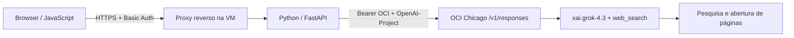

# Grok Web Search via OCI

POC de chatbot com interface JavaScript e backend Python/FastAPI. Usa `xai.grok-4.3` pela OCI Generative AI e habilita a ferramenta nativa `web_search` na Responses API. A aplicação chama exclusivamente o endpoint OCI.

## Estrutura

```text
.
├── app.py                          # Backend e autenticação
├── static/
│   ├── index.html                  # Interface e estilos
│   └── app.js                      # Chat, histórico e citações
├── requirements.txt
├── Dockerfile
├── .dockerignore
├── .gitignore
├── .env.example                    # Variáveis sem credenciais
├── validate.py                     # Validação REST com inferência real
└── evidence/
    ├── RELATORIO.md                # Resultados da POC
    └── validation-summary.json     # Evidências selecionadas
```

## Configuração

Requer Python 3.12 ou Docker, uma chave OCI Generative AI e um projeto GenAI ativo na região `us-chicago-1`, com permissão para inferência e Responses API.

Na raiz do repositório:

```bash
cp .env.example .env
chmod 600 .env
```

Preencha `.env`:

| Variável | Finalidade |
|---|---|
| `OCI_BASE_URL` | `https://inference.generativeai.us-chicago-1.oci.oraclecloud.com/v1` |
| `OCI_API_KEY` | Chave OCI Generative AI |
| `OCI_PROJECT_ID` | Identificador de projeto ativo em Chicago |
| `APP_PASSWORD` | Senha forte para o usuário `poc` |
| `APP_BASE_URL` | URL pública ou local, com o prefixo de publicação; usada por validate.py |

`.env` é ignorado pelo Git e pelo build Docker. As credenciais OCI ficam no backend. O histórico de conversa permanece na página e é reenviado a cada turno.

## Executar localmente

```bash
python3 -m venv .venv
. .venv/bin/activate
pip install -r requirements.txt
set -a
. ./.env
set +a
uvicorn app:app --host 127.0.0.1 --port 8080
```

Abra `http://localhost:8080/`. A autenticação solicita usuário `poc` e a senha definida em `APP_PASSWORD`.

Com Docker:

```bash
docker build -t poc-grok-websearch:1 .
docker run -d --name poc-grok-websearch --restart unless-stopped \
  --env-file .env -p 127.0.0.1:8080:8080 poc-grok-websearch:1 \
  uvicorn app:app --host 0.0.0.0 --port 8080
```

## Publicar na VM

Copie o repositório e configure `.env` na VM. Faça o build com o [Dockerfile](Dockerfile) e execute o container em uma rede acessível ao proxy reverso. Publique por HTTPS, encaminhando para a porta interna `8080`.

O comando padrão da imagem configura `--root-path /grok-poc`. Para esse modo, publique em `/grok-poc/` e remova o prefixo `/grok-poc` no proxy antes de encaminhar ao backend. Para publicação na raiz do domínio, use o comando uvicorn sem `--root-path`, como no exemplo Docker acima. Ajuste `APP_BASE_URL` para a URL completa, incluindo o prefixo quando usado.

Basic Auth requer HTTPS fora do ambiente local. A POC limita a concorrência a duas inferências, mas não impõe limite financeiro por usuário nem rate limiting por cliente.

## Arquitetura



O backend envia `tools: [{"type":"web_search"}]`, `store:false` e limite de 2400 tokens de saída. O modelo decide quando pesquisar e pode reformular consultas. Não há fallback para outros provedores nem motor de busca externo implementado pela aplicação.

A Oracle informa que os modelos Grok acessados pela OCI são hospedados externamente pela xAI. A aplicação autentica e chama exclusivamente OCI. Veja a [documentação Oracle](https://docs.oracle.com/en-us/iaas/Content/generative-ai/api-keys.htm).

Nos testes de 14/10/2026, `/openai/v1/responses` rejeitou `web_search` para Grok; `/v1/responses` e `/20231130/actions/v1/responses` funcionaram com um projeto ativo de Chicago. A aplicação usa `/v1/responses`.

## API REST

`POST /api/chat` com HTTP Basic. Na publicação com prefixo, use `POST /grok-poc/api/chat`.

```json
{"message":"Pesquise uma notícia publicada hoje e cite fonte e data.","history":[]}
```

`history` aceita até 12 turnos com `role` igual a `user` ou `assistant`; cada conteúdo tem limite de 8000 caracteres. A resposta contém `answer`, `citations`, `web_search_calls`, `usage`, `response_id`, `model`, `timestamp`, `seconds` e `raw_response`.

Exemplo local; curl solicita a senha:

```bash
curl --user poc http://localhost:8080/api/chat \
  -H 'Content-Type: application/json' \
  --data '{"message":"Pesquise uma notícia publicada hoje e cite fonte e data."}'
```

`GET /health` retorna o estado do serviço sem autenticação. A página, JavaScript e chat exigem autenticação.

## Validar

Com o serviço em execução e `.env` preenchido:

```bash
. .venv/bin/activate
set -a
. ./.env
set +a
python validate.py
```

O [script](validate.py) faz uma chamada paga de inferência sobre notícia de hoje, verifica resposta, eventos de busca e citações, além dos códigos HTTP de autenticação e validação. Salva resultados locais em `./evidence/`, ignorados pelo Git. A confirmação da data e do conteúdo da fonte requer conferência independente; o script não a automatiza.

Na execução original, o REST retornou HTTP 200 em 36,12 segundos, com duas buscas concluídas e uma abertura de página após uma tentativa inicial falhar. A fonte foi acessada independentemente e mostrou publicação em 14/10/2026 às 08:17. Desktop e celular passaram nas verificações de JavaScript e layout. A renderização foi verificada com uma fixture da resposta REST real.

Consulte o [relatório](evidence/RELATORIO.md) e o [resumo estruturado](evidence/validation-summary.json). Apenas evidências selecionadas são compartilhadas; credenciais, dados administrativos OCI, respostas brutas, cópias integrais das fontes e scripts específicos da infraestrutura ficam locais.
